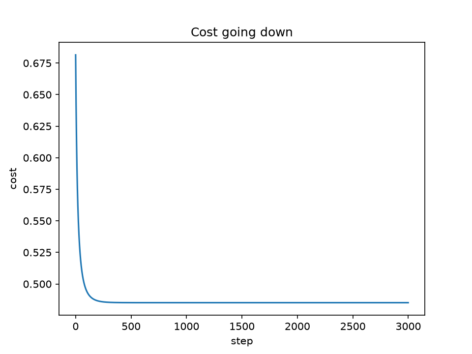

# Good Run Classifier

Predicts whether a run will be a good run (faster than my usual pace
for that type of run) using logistic regression written from scratch
in NumPy, then verified against scikit-learn.

## Results

| Model                          | Test accuracy |
|--------------------------------|---------------|
| Baseline (always "bad run")    | 0.630         |
| My NumPy logistic regression   | 0.741         |
| scikit-learn LogisticRegression| 0.741         |

My weights match scikit-learn's to 3 decimal places, with and
without regularization (lambda = 1 matches C = 1).

## What I built from scratch

- Z-score feature scaling
- Sigmoid, log loss cost, gradients
- Gradient descent (converges to cost 0.4852)
- L2 regularization

## Findings

- Biggest factor: km run in the last 7 days. Heavy weeks mean
  fewer good runs.
- Rest days help: more days since the last run means more
  likely to be a good run.
- Regularization: accuracy stayed at 0.741 for every lambda, but
  test log loss rose from 0.48 to 0.67. At lambda = 1000 every
  probability was between 0.45 and 0.54. Accuracy hid the
  underfitting; log loss showed it.

## Data

Synthetic Strava-style data (269 runs), cleaned in my Run Pace
Predictor project. "Good run" = faster than the median pace of
training runs of the same type (easy under 8 km, steady 8 to 12 km,
long over 12 km), using training data only to avoid leakage.

